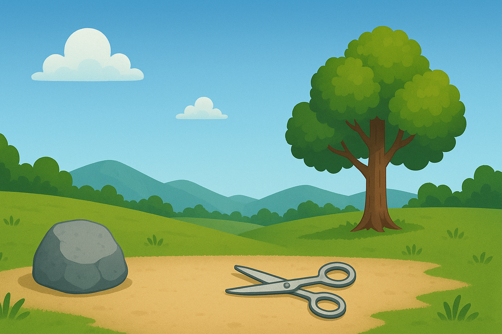
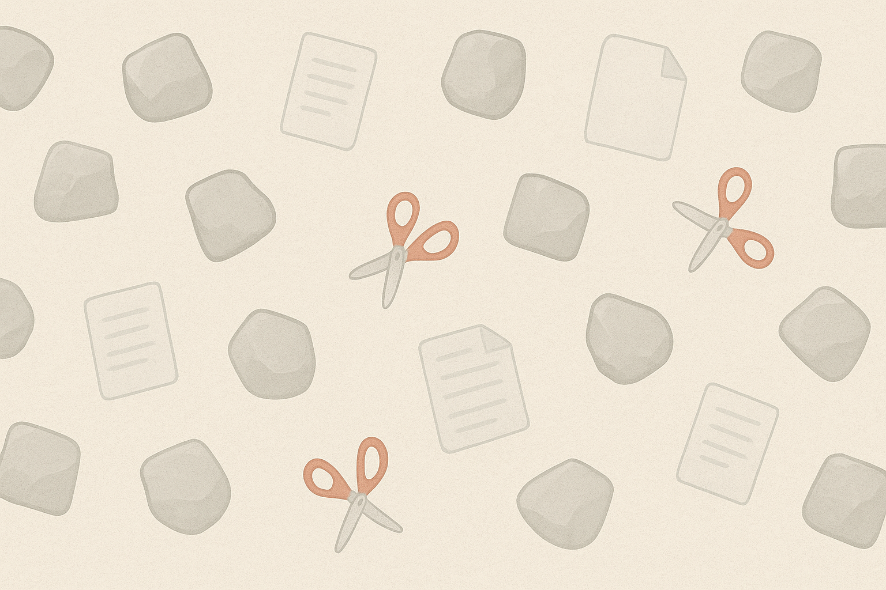
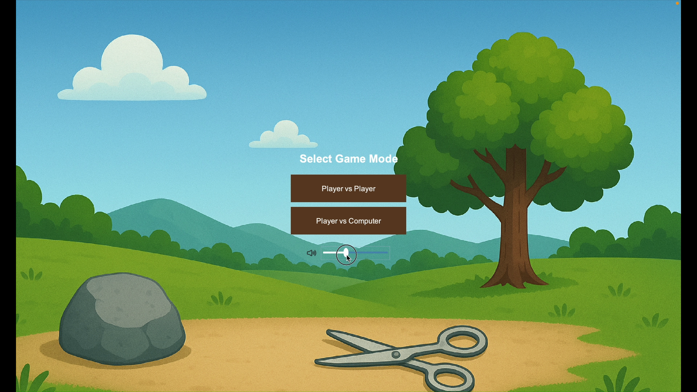
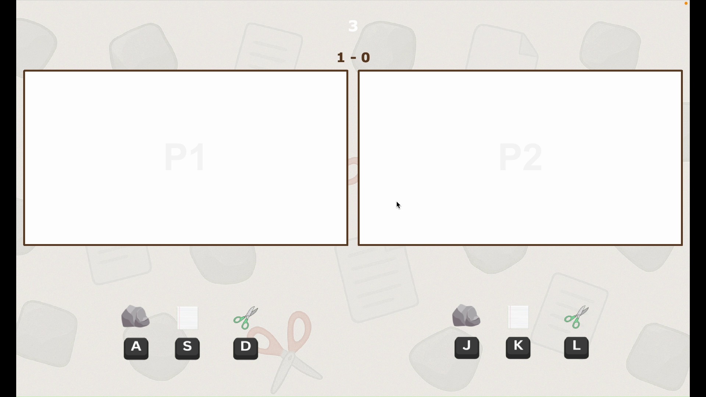
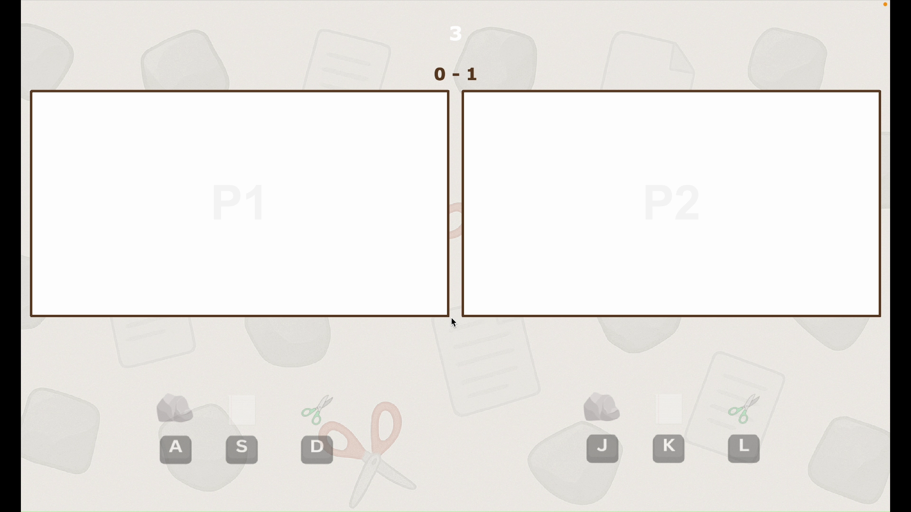
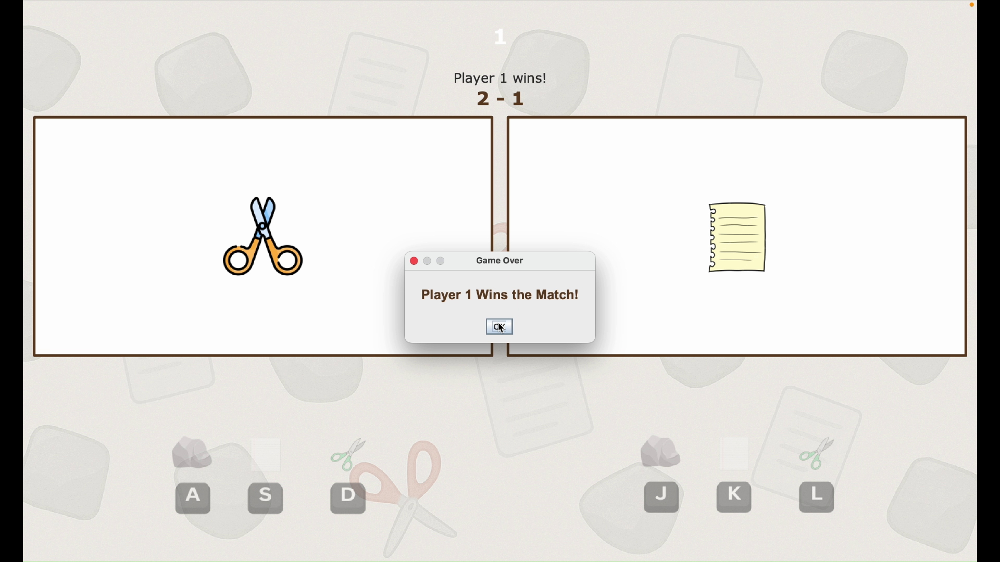

# ✊ Rock Paper Scissors ✋

### A classic game, with a little more personality.

A Java Swing desktop game featuring two-player matches, a computer opponent, custom visuals, background music, and sound effects.


---

## 🎬 Gameplay Demo

Click the thumbnail below to watch the full gameplay demonstration.

[](https://youtu.be/-6DZH_AQmmg)

**[▶ Watch the full demo on YouTube](https://youtu.be/-6DZH_AQmmg)**

---

## 🎮 About the Game

This project brings the classic Rock Paper Scissors game to desktop with a graphical interface built using Java Swing.

Choose to challenge the computer or play against another person on the same keyboard. Each match features a countdown, score tracking, custom gesture artwork, and audio feedback.

## ✨ Features

| Feature | Description |
|---|---|
| 👤 Player vs Computer | Challenge a computer opponent |
| 👥 Player vs Player | Play against another person |
| ⏱️ Countdown | Three-second countdown before each round |
| 🏆 Match scoring | Matches of up to three rounds |
| 🔊 Sound effects | Audio feedback for game interactions |
| 🎵 Background music | Menu music with adjustable volume |
| 🎨 Custom visuals | Backgrounds and gesture artwork |
| ⚖️ Fair-play detection | Detects repeated key selections in PvP mode |

## 🕹️ How to Play

### Game modes

- **Player vs Computer:** Play against the computer.
- **Player vs Player:** Challenge another player using the same keyboard.

### Keyboard controls

| Action | Player 1 | Player 2 |
|---|:---:|:---:|
| Rock ✊ | `A` | `J` |
| Paper ✋ | `S` | `K` |
| Scissors ✌️ | `D` | `L` |

### Match rules

- Each round starts with a three-second countdown.
- Players must select their moves before time runs out.
- Rock beats scissors.
- Scissors beat paper.
- Paper beats rock.
- Identical moves result in a tie.
- Matches finish after three rounds or when a player secures a winning lead.

## 🖼️ Game Artwork

The project includes custom menu and gameplay backgrounds, alongside individual gesture illustrations.

<table>
  <tr>
    <td align="center" width="50%">
      **Menu Background**

      
    </td>
    <td align="center" width="50%">
      **Gameplay Background**

      
    </td>
  </tr>
</table>

## 🚀 Getting Started

### Requirements

- JDK 14 or newer
- Eclipse IDE (recommended)

### Option 1: Eclipse IDE

1. Clone or download the repository.
2. Open Eclipse.
3. Select **File → Import → Existing Projects into Workspace**.
4. Select the `game` folder.
5. Open `src/main/java/rockpaperscissors/RockPaperScissorsGame.java`.
6. Run it as a Java Application.

### Option 2: PowerShell

From the repository root:

```powershell
javac -d out game/src/main/java/rockpaperscissors/RockPaperScissorsGame.java
Copy-Item -Path game/src/main/resources/* -Destination out -Recurse
java -cp out rockpaperscissors.RockPaperScissorsGame
```

## 🗂️ Project Structure

```text
RockPaperScissorsGame/
│
├── RPS.jar
│
├── Seperate Java File/
│   └── RockPaperScissorsGame.java
│
└── game/
    ├── .classpath
    ├── .project
    │
    └── src/
        └── main/
            ├── java/
            │   └── rockpaperscissors/
            │       └── RockPaperScissorsGame.java
            │
            └── resources/
                ├── audio/
                │   ├── cheating.wav
                │   ├── countdown.wav
                │   ├── hover.wav
                │   ├── menu_music.mp3
                │   ├── menu_music.wav
                │   ├── select.wav
                │   └── show.wav
                │
                └── icons/
                    ├── game_bg.jpg
                    ├── menu_bg.jpg
                    ├── paper.png
                    ├── player1_waiting.png
                    ├── player2_waiting.png
                    ├── rock.png
                    ├── scissors.png
                    └── sound-icon.png
```

## 🛠️ Tech Stack

| Layer | Technology |
|---|---|
| Programming language | Java |
| Desktop interface | Java Swing |
| Graphics | Java AWT |
| Audio | Java Sound API |
| IDE project | Eclipse |

## 📌 Notes

- Keep the resources directory on the runtime classpath.
- The project uses Java switch expressions and requires JDK 14 or newer.
- Both an Eclipse project and a standalone Java source copy are included.

---

## 🖼️ Game Screenshots

### Main Menu


### Player vs Player


### Player vs Computer


### Match Result



---

<div align="center">

**Made with Java ☕**

If you enjoyed the project, consider giving it a ⭐.

</div>
